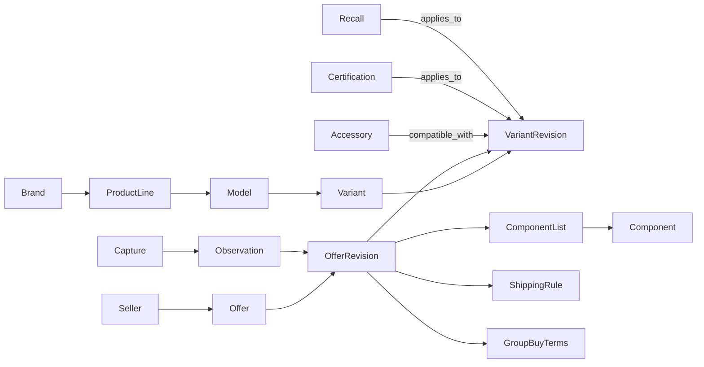

# 02 · 온톨로지와 디지털트윈

[대표 질문](01-questions.md) · [용어](README.md#공통-용어) · 다음: [원장](03-fact-metadata-and-history.md)

## 질문에서 개체로

제품(브랜드·라인) → 모델 → 연식·옵션 → 판매처별 판매 조건의 순서로 식별한다. 판매처는 제품의 하위 종류가 아니라 Offer를 통해 연결되는 별도 개체다. 모든 속성과 관계는 [fact 메타데이터](03-fact-metadata-and-history.md)를 가진다. 이름이 비슷하다는 이유로 호환·공식 수입·구성 포함 관계를 만들지 않는다.

| 개체 | 주요 속성·관계 | 경계 |
| --- | --- | --- |
| Brand / Product line / Model | 브랜드·라인명, `belongs_to` | 기존 `model-N` 보존. 브랜드·모델 분류 변경도 근거 필요 |
| Variant | 연식·세대·색상·재질·구성 변형, model 참조 | 모르는 연식은 unknown이며 출시 연도로 추정하지 않음 |
| Variant revision | 제조사 기본 구성·사양, 기간, 이전 판 | 구성·사양 변경마다 새 판 |
| Seller | 판매처 식별·채널·법인 단서, 별칭 | 로컬 seller_candidates는 검수 전 후보. 사이트 sellers 자동 등록 금지 |
| Offer | seller × variant × 채널 목록 식별자 | ID만 안정. 조건은 revision으로 분리. URL 변경은 근거 확인 후 별칭으로 연결 |
| Offer revision | variant revision, 구성 목록, 배송 규칙, 공구 조건, 기간 | 발행 후 내용 불변, 종료 필드만 한 번 닫음 |
| Component / ComponentList | 부품 ID, 명시 수량·옵션, 근거 fact IDs | 포함품과 별도 판매품·사은품 구분 |
| ShippingRule | 기본 운임·무료 기준·지역 추가비·제외 조건·통화 | 조건 미확인 시 배송비 정보 없음. 기본 0원으로 채우지 않음 |
| GroupBuyTerms | 시작·종료·최소 인원·사은품·충족 증거 | 최소 인원 존재와 실제 충족을 분리 |
| Accessory | 부품 번호, `compatible_with` 대상 revision·로트·예외 | 원문 근거가 있는 대상에만 연결 |
| Certification | KC 유형·번호·기관·대상 모델·연식·발급/만료일 | DB 레코드 존재와 제품 적용 관계는 별도 fact |
| Recall | 기관·공고 ID·유형·대상 모델/로트·발표/수정일 | `kr_applicability=applies/not_this_model/unknown`, 사람 판정 |

## 안정 ID·별칭

기존 `model-N`은 재번호화하지 않는다. 신규 예시는 `brand:stokke`, `line:stokke/tripp-trapp`, `variant:model-1/beech`, `vrev:<variant>@<n>`, `seller:<uuid>`, `offer:<uuid>`, `orev:<offer>@<n>`이다. 새 개체는 최초 식별 뒤 이름·URL 변경으로 ID를 바꾸지 않는다. 별칭은 `entity_aliases(entity_id, alias_norm, data)`에 원문·출처·적용 범위를 보관한다. 다국어·철자 별칭의 선례는 seed `match_terms`다. 같은 별칭을 여러 대상이 쓸 수 있어 별칭 단독으로 병합하지 않는다. 병합·분리 결정도 검수 이벤트와 ID redirect 계보를 남긴다.

`dedup_group_id`는 문서·계보 묶음이며 `entity_id`가 아니다. 한 문서가 여러 제품을 언급할 수 있고 한 제품에 여러 문서가 연결될 수 있다.

## Revision과 현재 projection

Offer revision은 구성품·수량·옵션, variant revision, 배송 규칙, 공구 기간·최소 인원·사은품 중 하나라도 **verified 근거로 변경 확인**되면 새로 만든다. 가격·재고 변화만으로 revision을 늘리지 않는다. 가격은 같은 revision 안에서 fact 구간을 바꾸고, 모든 관측은 Observation으로 누적한다.

제조사 기본 구성이 바뀌면 Variant revision을 새로 만든다. 각 Offer는 판매처 본문에서 새 구성이 확인된 때만 새 variant revision으로 옮긴다. 확인 전 이전 revision을 유지하되 현재 Q1의 bundle_status를 partial로 계산하고 “제조사 구성 변경 후 판매처 미확인”을 남긴다. 이전 시점의 confirmed 판단은 지우지 않는다.

새 Offer revision의 적용 시각 T1을 검증한 뒤 한 `BEGIN IMMEDIATE` 트랜잭션에서 이전 revision의 `effective_to=T1`, 이전 열린 가격 fact의 `effective_to=T1`, 새 revision 추가, 필요한 twin 전이를 처리한다. 확인된 새 가격이 있을 때만 새 가격 fact를 추가한다. 이전 가격 복사 금지. 이전 revision이 이미 닫혔거나 T1이 역순이면 자동 갱신하지 않고 검수한다.

현재 projection은 T를 포함하고 `superseded_by IS NULL`인 revision·가격 구간과 상태를 선택한다. 구간은 반열린 `[effective_from, effective_to)`이다. 구성 근거·검증·상충·재확인 유효성도 [01 규칙](01-questions.md)에 따라 계산한다. 가격과 조건이 다른 revision을 join하지 않는다.

## Observation과 추적 대상

Observation은 `(offer_revision_id, capture_id)`마다 한 건이다. `observed_at`, 가격 종류·값·통화·재고, fact_status, 근거 IDs를 append-only로 보관한다. 내용이 같아도 새로운 run의 capture이면 새 관측이다. 검수 결과는 원래 observation을 수정하지 않고 review/fact 연결로 보완한다.

관계 그래프만으로 디지털트윈이라 부르지 않는다. 트윈 대상은 **Offer 상태, Offer revision 기간, 가격 구간, Model의 리콜·인증 상태**다. 원문 변경을 확인·검증한 이벤트가 이 상태와 이력을 갱신한다. Model 안전 상태는 해당 대상별 인증·리콜 fact 집합으로 계산하며 “안전” 단일 boolean으로 축약하지 않는다.

| 현재 → 다음 | 전이 조건 | 이전 기록 닫기 |
| --- | --- | --- |
| 없음 → announced | 검수된 공지, 시작일 미래 | 신규 상태 entered_at=근거 적용 시각 |
| announced → active | starts_at 도달 + 판매처 본문 확인 | 이전 exited_at=starts_at. 실제 판매 개시가 더 늦으면 확인된 개시 시각 사용 |
| active → sold_out | 검수된 품절 관측 | 첫 품절 observed_at으로 닫고 change window 기록 |
| sold_out → active | 검수된 재입고 관측 | 첫 재입고 observed_at으로 닫음 |
| announced/active/sold_out → ended | 검증된 ends_at 경과 또는 마감 공지 | 알려진 종료 후보 중 가장 이른 시각. 단 entered_at보다 앞선 후보는 검수 |
| 모든 비철회 상태 → withdrawn | 관리자 철회(0011 선례) | 철회 시각으로 닫음. 최종 상태, 재게시하려면 새 Offer와 연결 근거 |
| 구성·조건 변경 | 검수된 새 Offer revision | 위 revision 트랜잭션. 상태 유지도 원인 이벤트로 추적 |
| 가격 변경 | 새 verified 가격 fact | 이전 effective_to=새 effective_from, 새 가격 추가 |
| 리콜 발생·수정 | 공공 레코드 + 적용 대상 판정 | Model 대상별 상태 구간 추가. unknown 적용도 그대로 기록 |
| 인증 확인·만료·취소 | 공공 레코드·검수된 대상 + 명시 날짜 | 대상별 이전 인증 상태 닫고 새 상태 추가 |
| stale | 저장 상태 아님 | last_confirmed_at + recheck 경과로 계산. 닫을 행 없음 |

명시된 starts_at·ends_at을 시간 이벤트로 처리할 때 원인 fact와 타이머 키를 기록한다. 단순히 시작일이 왔다고 자동 active로 만들지 않는다. 마감일 자동 종료는 검증된 마감 조건을 근거로 한다. 관측 기반 적용 시각이 현재 entered_at보다 이르면 현재 상태를 닫지 않고 검수 큐로 보낸다. 정확한 변경 시각 미확인 시 [03의 변경 창](03-fact-metadata-and-history.md)을 보존한다.

## 서비스별 분리

공통 수집 인프라에는 도메인 규칙을 넣지 않는다. 공유 가능한 런타임 기능과 아가마중 전용 데이터의 경계는 [README](README.md#범위와-시스템-경계)를 따른다. DB·검수 권한·원문 접근·Instagram halt는 서비스 namespace와 자격 증명을 분리한다. 사이트가 Linux DB나 raw 경로에 직접 접근하는 설계는 두지 않는다.
